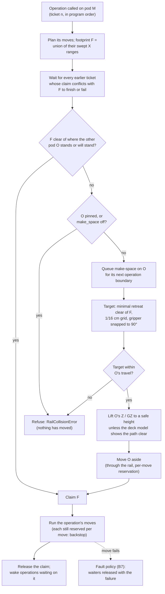
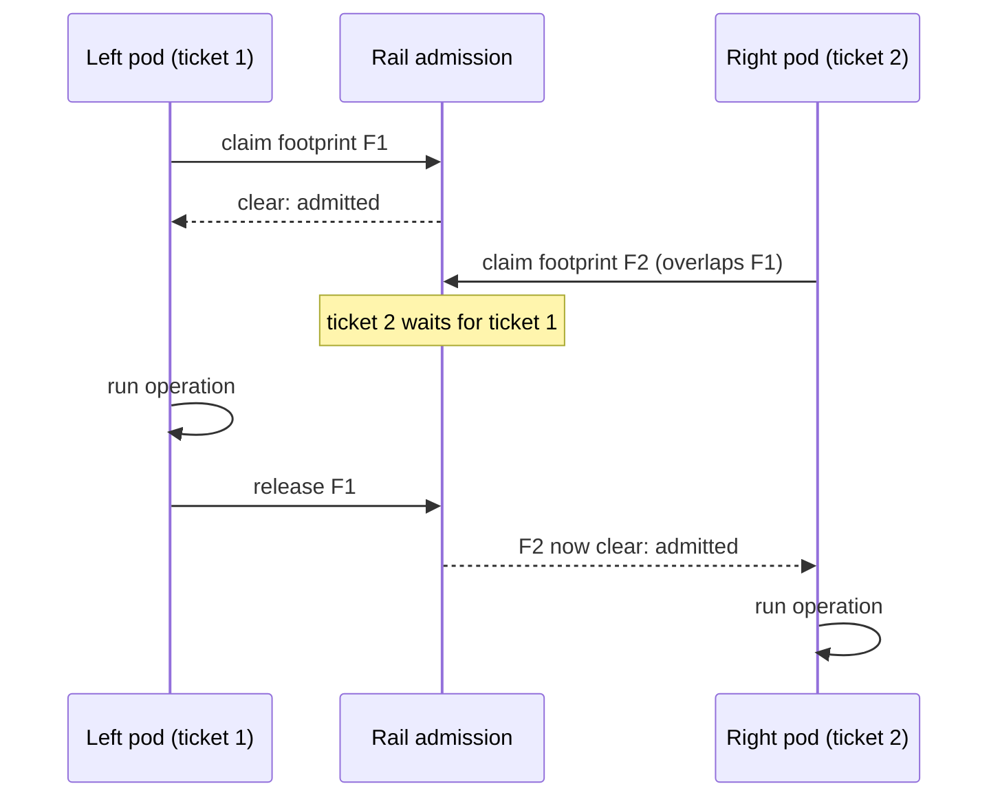

# How this integration is built

The patterns the Biomek i7 integration is written to. A new feature follows them, and an existing
one can be checked against them. The integration follows the STAR's
(`pylabrobot/hamilton/star/design.md`, patterns P1–P20) and says here only where the Biomek
differs or adds something. The work that brings the code in line with this document is tracked
outside the package, in the reverse-engineering workspace's `ARCHITECTURE_TRACKER.md`.

## What makes the Biomek different

A STAR's firmware takes operations in its own units ("pick up tips here") and plans the motion
itself. A Biomek's boards take one axis at a time, in encoder counts. Three layers of Beckman
software sit between a method and the boards:

- **Biomek** (the application) plans operations: mm/µL to counts, tip moves, safe heights, paths
  round the deck, collision with the other pod, and liquid techniques.
- **The Master Controller** (MC) takes host commands in counts (`AM`, `HM`, `LT`, `SF`, …). It plans coordinated motion, keeps each axis's
  position, and talks to the boards.
- **The ACE boards** (one per pod, one chassis) take single-axis firmware commands over USB.

This driver replaces the top two layers. Each of its layers reproduces one of them, and is checked
against the log Biomek keeps for that layer.

## The layers

| Layer | Modules | Ports | Checked against |
|---|---|---|---|
| L1 wire | `driver/framing.py`, `board.py`, `protocol.py`, `errors.py` | ACE messages | Log.db3 `ace_io`, byte for byte |
| L2 firmware commands | `_unchecked_fw_*` on `Pod` and `Chassis` | one board request each | `ace_io`, per request |
| L3 MC equivalent | the public primitives on `Pod` (`move_axes`, `home`, …), recipes (`features/homing.py`), `driver/motion.py` | MC host commands | Log.db3 `host_command` and the `ace_io` each produced |
| L4 planning | `driver/pod_geometry.py`, `driver/x_rail.py`, the conversions on the configuration | Biomek's planning | Biomek's `Details` and `Pipetting` logs, and the host commands they produced |
| L5 PLR | `device.py`, the operation features (`head96`, `pipettes`, `gripper`), `resource_model/`, `deck.py`, `layouts.py` | PLR | the PLR API and the simulator |

Each layer calls only the one below it. L3 and L4 are pure where they can be: `motion.py` and
`pod_geometry.py` do no I/O, as the PreciseFlex's `kinematics.py`.

```
device.py            BiomekI7, a Resource. Its deck is its child. Accessors read through to the
                     driver's features.
driver/master.py     BiomekI7Driver: the boards, discovery, initialization, the declared
                     configuration, the rail guard. (The pods' models are the device's: B5.)
driver/features/     chassis.py; pod.py (one per pod, the STAR's X-arm); head96.py, pipettes.py,
                     gripper.py on the pods; homing.py and tip_load.py, the MC's multi-step
                     commands as recipes.
driver/simulator.py  A simulated instrument at the wire: each axis, the interlock, the door.
                     Moves are instant, or take the instrument's time (`time_scale`, from each
                     move's distance, speed and acceleration) so a run can be watched; the Span-8's
                     tip sensor can report the session's tips (`sense_recorded_tips`).
```

No instrument's data ships with the package: its declared configuration (motor tables, per pod
the conversions, limits, geometry and settings; the deck's calibrated positions) and the simulator's
cold-start recording are given by path, or by `$BIOMEK_I7_CONFIGURATION` and
`$BIOMEK_I7_SIMULATOR_RECORDING`. So is the deck layout (`BiomekI7(deck=...)`; the default is
empty).

## Feature map

| STAR | Biomek | Notes |
|---|---|---|
| `x_arm` (left, right) | `left_pod`, `right_pod` (`Pod`) | One ACE board each; one shared X rail |
| `pipettes` | `right_pod.pipettes` (Span-8, 8 channels) | Independent Z and Y-span; syringe pumps with valves; liquid-level sensing |
| `head96` | `left_pod.head96` (Multichannel, 96 channels) | Force-limited tip load (`LT`); D-axis shuck to eject |
| `core_grippers` / `iswap` | `<pod>.gripper` (both pods) | GY, GG, GZ, GR; grip by force-limited close, checked by control effort |
| `cover` | `chassis` (door, interlock, status display) | |

A feature exists only once discovery says it is fitted (P2): `Pod` builds them from the module
type discovery read, so `left_pod.pipettes` is `None` on a Multichannel pod.

Pods are named by side, as STAR names its arms: the side is what is physically fixed, and
Biomek's numbering (Pod1 = left) is only confirmed on one instrument. Biomek's names stay on each
pod (`pod_number`, `component` such as `MC_1`), and `driver.pod(name)` finds a pod by any of them
(`"left"`, `1`, `"Pod1"`, `"MC_1"`) for porting Biomek methods and logs.

**Shortcuts.** `driver.head96` / `.pipettes` / `.gripper` (and the same on `BiomekI7`) give the
feature when exactly one pod carries it, `None` when none does, and refuse when both do, naming
`left_pod.<feature>` / `right_pod.<feature>`. On the instrument this was written for, `head96`
and `pipettes` resolve and `gripper` refuses. This is STAR's `_require_one_arm`, but per feature,
since a Biomek's two pods carry different things.

**What stays on the pod.** A pod's axes, head, channels and gripper are all driven by one board
through one position record, and one coordinated move can mix them. So the pod keeps the shared
mechanics: `move_axes`, `cpositions`, homing (`HM`), enabling, the rail pose, the `request_*`
reads and every `_unchecked_fw_*`. The features send through it. The pump valves, cutoff and held
labware live in the pod's state, as the MC keeps them in its pod state record, because moves
read them; the features are their only public writers.

**Two movement levels**, as Biomek splits motion:
- `pod.move_axes`: one MC `AM` on one board, every axis of that pod arriving together.
- `driver.move_axes({"left": …, "right": …})`: both pods' moves at once, admitted together by the
  rail (B7). There is no cross-pod move in hardware; Biomek runs pods concurrently the same way.

## Patterns that differ from the STAR or add to it

**B1. The driver plans what Biomek and the MC planned.** Moves are planned here, not on the
device. Every behaviour reproduced here is checked against what Biomek's logs record of it, and its
docstring says what it was checked against (how many logged runs or moves it reproduces).

**B2. Positions are kept as the MC keeps them.** Each axis has `(position, adjusted)`
(`cpositions`). Moves are planned from where the driver last put the axis, not from a read. An
axis whose position is unknown (after homing, a force-limited move or a failure) is enabled and
read before the next move, as the MC's logs show it doing, and that is what makes moves
byte-identical to Biomek's.

The L3 primitives, each one MC host command (counts in, counts out):

| Method | MC | What it sends |
|---|---|---|
| `pod.move_axes(targets, speed, forces=, sensors=)` → `MoveResult` | `AM` (with `SF`) | position reads where unknown, Set Move Parameters per axis (force ×1000, sensor and trigger; pumps with start, cutoff and valve), Move All. Force-stopped axes become unknown; a sensor stop's reported position becomes the axis's and is in `MoveResult.completions` |
| `pipettes.set_cutoff_velocity(v)` | `CV` | nothing; the pumps' next moves carry it |
| `pipettes.set_lls_sensitivity(v)` | `SS` | Set LLS/CD Sensitivity on the LLS board (0..4095) |
| `pipettes.set_valves({pump: valve})` | `VI` `VO` `VB` `VE` | position reads where unknown, pump Set Move Parameters at the current position with the new valve, Move All 6000 |
| `gripper.request_control_effort(axis)`, `gripper.check_grip(expect_labware)` | `AG` `AU` | Get Control Effort on GG; labware held below −200 |
| `pipettes.request_tip_status()`, `pipettes.verify_tips({probe: has_tip})` | `GT` `VT` | Get Tip Status (0 tip, 1 cannot tell, else no tip) |
| `pod.home()`, `head96.home_plunger()` | `HM` `HD` | the recorded recipes (`features/homing.py`) |
| `head96.load_tips(TipLoad)` → loaded Z | `LT` | the MC's `LT` (`features/tip_load.py`): D to load, Z pressed force-limited, settle, read Z, relieve, leave, D back. `TipLoad.from_configuration(pod, seat_z, tips)` computes the arguments Biomek sends, as logged |

The MC keeps `SF` per axis until the next `SF`; `move_axes` takes the force per call instead, so
a caller passes it on each move that should be force-limited (the grip close). The validators
are `tools/validate_motion.py`, `tools/validate_l3.py` and `tools/validate_lt.py`.

A move's per-axis requests go out in the order the MC's logs show them
(`motion.spawn_order`: 1..5 as 1, 3 2, 5 4), motors and pumps in one batch, so the driver's
traffic lines up with Biomek's request for request.

**B3. Configuration is declared, with provenance.** `DeviceConfiguration` holds the facts the
boards cannot report:
- motor tables;
- home positions and hysteresis;
- pod geometry;
- the mm/µL ↔ counts conversion for every axis;
- frames and channel mapping;
- tip-load and grip facts.

Each value carries its source (`bif:<path>`, a default, `measured <date>`). Sources that write
it:
- importers from Biomek's files (the `.bif` instrument file, a MC recording);
- the MC's own defaults, ported from its source;
- calibration routines, later.

`save_configuration` writes it and `declared_configuration_json` reads it back; discovery
cross-checks what the boards can say (module type, side, serials). Runtime state that persists
between sessions, such as tips on the 96 head (which has no tip sensor), is kept separately.

**B4. Pod against pod is the driver's job.** The pods share one X rail and nothing below the driver
stops them colliding. The rule is Biomek's own, checked against every move it logged:
- each pod's X range is the union of its bridge, its pipettor (with a margin) and its gripper,
  turned and opened as it is, with any labware it holds (`Pod.set_held_labware`);
- before a pod moves, its swept range (start pose ∪ end pose) must not overlap the other pod's
  range or a move the other pod has in flight;
- a move crossing only the path of the other pod's running move waits for it to finish;
- otherwise the move is refused before anything is sent. Biomek moves the other pod clear first;
  that is deferred (tracker phase 4d). Until then a caller makes room explicitly:
  `Pod.move_aside()` takes a pod to its own end of the rail, `Pod.park()` to its park.

Every move of X, GR or GG goes through it. The same gripper model sizes the gripper in the
resource tree (phase 5), so the visualizer shows what the guard counts.

**B4a. Sharing the rail between operations: deterministic admission.** (Designed; the per-move
reservations above are built, the rest is tracker phases 4c and 4d.)

Two pods can run operations at once (pick up tips, aspirate, move a plate). Order and safety
must not depend on timing:

- **Tickets in program order.** Every operation takes a ticket when it is called. Conflicts are
  resolved in ticket order, never by which pod reaches the rail first. The same program from the
  same state makes the same decisions every run.
- **Claim the whole footprint before starting.** An operation is planned before it runs, so its
  X footprint is known: the union of the swept ranges of all its moves. It is admitted once, up
  front, and never waits on the rail part-way through.
- **Make space only between operations.** If the other pod is in the way and may move, a
  make-space move is queued for it at its next operation boundary, the way Biomek moves the other
  pod clear.
  - It is Biomek's target: the minimal retreat just clear of the claim (1/16 cm grid), gripper
    snapped to a multiple of 90°.
  - It lifts first: Z and GZ to a safe height unless the deck model shows the path clear; fully
    up without a deck.
- **Pinning.** A pod can be pinned (kept from being moved clear). A claim
  that needs a pinned pod to move is refused at admission, before anything moves.
- **No timeouts in scheduling.** A waiting operation waits for the one ahead of it to finish or
  fail. Every move has its hardware bound (Move All timeout = planned duration + 5 s), and a
  failure releases waiters with that failure. A stuck pod is a fault, handled by the fault policy
  (B7), not a scheduling decision.
- **Sequential by default.** One call completes before the next, as in PLR generally. Running
  pods together is the caller's explicit choice (`asyncio.gather`).

Because no operation waits while holding a partial claim, waits cannot form a cycle: deadlock is
impossible by construction. The cost is some parallelism: an operation that conflicts waits for
the other pod's whole current operation. Claiming per operation phase (approach, act, depart)
would recover most of it with the same guarantees.





Where this matches Biomek and where it differs:

| | Biomek | Here |
|---|---|---|
| Rule, ranges, overlap | Biomek's | reproduced, checked against every logged move |
| Make-space target | minimal retreat, 1/16 cm grid, gripper to 90° | the same |
| Make-space path | A* path finder (heights, obstacles) | lift to a safe height, then retreat |
| Moving the other pod | between its actions (inferred) | at its next operation boundary |
| When it checks | before each move | before each operation, plus per-move reservations |
| Order of two pods | timing | program order |

The guard uses configuration, never the resource tree, so it holds with no deck.

**B5. The deck is optional, and the device holds the pods' models.** The driver works without a
deck: it homes, parks and moves, and the rail guard uses configuration only. `BiomekI7`, the
resource that holds the deck, holds a bridge and a pod model per side (`bridges`, `pod_models`).
Once the driver is set up, they are built from each pod's declared geometry (`pod_model`), and each
bridge follows its pod's X through `Pod.add_position_listener`. They are placed as Biomek places
the bridge and pipettor, so the tree's X extents are the rail guard's ranges
(`device_model_tests.py`). STAR's driver builds its resources instead (P12); here the device
already is the resource tree, so it does. The Multichannel's model also follows Y and Z; the
Span-8's channels are not followed (nothing logged checks them). The gripper model is still a box,
not posed from GY/GZ/GR/GG. Operation features, which take resources, need a deck.

**Biomek's frame on this deck** (checked against logged operations, `tools/validate_frames.py`):
X and Y name the head's mandrel A1 (over a 96-well plate, over well A1), in cm, with `deck.py`'s
`biomek_x` / `biomek_y` to about 0.03 cm. Z is the bare mandrel's bottom, in cm above the deck
surface (deck z = Biomek Z): per-position Z in the instrument file is in the same frame (logged
dispense heights at P6/P9/P12/P16 differ exactly as those positions' Z1 do), and the nominal ALP
site height 15.875 cm is the deck model's. The pod's corner is `Mandrel1XOffset` /
`Mandrel1YOffset` from mandrel A1.

**B5a. Targeting is PyLabRobot-native, with one Biomek correction** (`targeting.py`). As STAR and
Prep do, a target starts from the resource tree: `resource.get_location_wrt(deck, x, y, z)` +
offset, in mm. It goes into Biomek's frame (`deck.biomek_x` / `biomek_y`, Z = deck z, cm), and
then gets the moving pod's calibration of the deck position the resource stands on: Biomek moves
each pod relative to its own calibrated corner of the position (`DeckPosition.corner`, corner n
for pod n), up to ~0.1 cm from the nominal pin grid; the difference is added. Deck positions centre
their labware (`BiomekPosition`), as Biomek does. Without a `.bif`, the correction is zero and
positions are nominal. `tools/validate_targeting.py` replays every logged pickup and plate
operation: residuals ≤ 0.013 cm once whole well steps are removed (a Multichannel partial load aims
mandrel A1 4–7 rows ahead; the Span-8 picks column by column), the constant part being where
PyLabRobot's labware definitions differ from Biomek's classes (≤ 0.1 mm).

**B5b. Labware is Biomek's own.** `resource_model/labware.py` builds PyLabRobot tip racks, plates and
reservoirs from Biomek's labware and tip classes (`biomek_labware(class, name)`, data in
`biomek_labware.json`), and `layouts.place_labware` places a method's Instrument Setup. Targets then
match Biomek's logged moves to 0.0015 cm, which hand-made stand-in definitions do not (−0.0095 cm
with BCFlat96 for Thermo96VB_PP). A well's shape (`well_profile`) follows Biomek's segments by their
radii (a round bottom is a spherical cap; a reservoir section a box): every segment's own
`sectionvolume` comes out, and so do the logged liquid levels.

**B5c. Where a tip's end is, from Biomek's definitions**, checked against the logged tip moves. No
constant here is fitted:
- **Effective tip length** = the tip class's `TipHeight` − a seating depth: the pod's
  `TipSeatingDepth` on the Multichannel (0.7074 cm), the tip class's `SpanSeatingDepth` on the
  Span-8 (0.775). The tip end is the channel's Z less it. PyLabRobot's
  `tip.get_size_z() - tip.fitting_depth` is the same rule; our tips carry `fitting_depth` =
  `SpanSeatingDepth`, so the Span-8 uses it as is and the 96-head substitutes its own depth
  (`Head96.effective_tip_length`, a deliberate difference from STAR).
- **Labware offsets per position and class**: an ALP's `LabwareOffsets` (only `TipLoad1x1` has
  any: −0.254 cm for tip boxes, −0.23…−0.001 for some plates) move where the labware sits.
  `BiomekPosition` applies them when labware is placed, so the resource tree holds the labware where
  it physically is and the 96-head's seat is just the rack's top.
- **Trash disposal**: a trash position's `TipDisposalOffsetX/Y/Z` (and `Span8TipDisposalOffsetX/Y`)
  from the ALP's `CustomData`, carried as `BiomekPosition.tip_disposal`.

**B6. Units.** L5 and the public API take mm, µL, s, mm/s and N. L3 and below work in counts and
Biomek's speed field (1..1000 per mille of each axis's maximum). Biomek's own files are in cm, and
its frame has Y towards the front; `deck.py` and the configuration convert. **Exception until
calibrated:** force limits are in the MC's own units (the value it multiplies by 1000 for the
board), named as such, because their relation to N is not known.

Heights given to the operation features (`head96.*`, `pipettes.*`: `minimum_traverse_height_*`)
are mm above the deck, PyLabRobot's z (Biomek's Z × 10), of the tool's **lowest point**: the end
of the tip a channel carries, else the channel's bottom, as STAR's and the Prep's are. `Pod`'s
travel (L4, `move_over`, `lift_channels`) works in Biomek's cm; the features convert.

**B7. Safety state.** The instrument rests with the interlock tripped. The driver arms it only to
move, and leaves it as it found it on `stop()` or a failure. A fault seen under power is cleared
by enabling, with a warning; a fault that will not clear trips the interlock and shows ERROR. These
are deviations from Biomek, which waits for an operator, and are listed as such.

**B8. Auditable against the logs.** Every L3 command has three things:
- an exporter (Biomek's logged runs);
- a validator over every logged run, which reports a match rate and lists what doesn't match;
- a stratified fixture that the tests replay (recorded from one instrument, so kept out of the
  package until the tests are reworked to need no instrument's data).

L3 logs one line per host command it carries out, in the MC's vocabulary, so a session of ours can
be compared with one of Biomek's.

**B9. Travel over the deck is a traverse height, not a path planner.** Biomek routes the pods
around deck obstacles with a path planner. This driver does not reproduce it.
Before X/Y travel, Z (and the gripper's GZ) rises to a traverse height:
- by default the height homing and parking leave it at, near the top of travel (the conservative
  choice); computed from the configuration's safe heights (`GlobalMinSafeHeight`,
  `AdditionalSafeHeight[Gripper]`, the held labware's height) and the tallest resource or `.bif`
  obstacle under the path, once the deck model's heights are trusted, as an option;
- overridable per command with a height at the start and at the end, as STAR's
  `minimum_traverse_height_at_beginning_of_a_command` / `z_final` and the Prep's equivalents, so an
  operator can program tighter travel;
- checked: an override below what the deck model needs raises before anything moves, unless the
  caller opts out explicitly. A move no traverse height can clear is refused, not routed.

Built as `Pod.move_over(targets, minimum_traverse_height=, z_final=, clearance=,
allow_below_clearance=, tip_lengths=)` and `Pod.lift_channels`, STAR's names, in Biomek's cm. A
given height is each channel's lowest point (STAR's `_traverse_raise_targets`): a channel's bottom
goes to the height + the length of the tip it carries, and a height a channel cannot lift its tip
to under its ceiling is refused. The tips come from the pod's own record (`carried_tip_lengths`:
the 96-head's and the Span-8 probes' session state; the Span-8's tip sensor checks it after each
load and discard). The default is defined on the channels' bottoms: each at its ceiling
(`traverse_ceilings`: the top of travel less the park margin; on the Span-8 also no higher than Z
max − `DiscardOffset`, above which the stripper pushes a tip off, where Biomek travels carrying
probes), or at `Pod.default_minimum_traverse_height` where that is lower. The deck's clearance is
always checked against the tips' ends. `default_minimum_traverse_height` is STAR's
`default_minimum_traverse_height` and Biomek's Hardware Setup "Safe Height" (`GlobalMinSafeHeight`,
from which it is seeded when set). Biomek uses that setting as a floor under each travel's
computed height (max(GlobalMinSafeHeight, what is under the move) + `AdditionalSafeHeight` + the
avoidance margin, as its logged travel heights show), so set near the top it makes every move rise to
the top first; the Master Controller has no such setting (its `AM` carries whatever Z Biomek
sends). On this instrument it is unset (-100000), and Biomek travels at the computed height
(about 30 cm over the plates); unset here means the top of travel less the park margin (the
Multichannel's rest Z, 39.763 cm, -256 counts), as Biomek with Safe Height at the top. The path's
needs come from the obstacles Biomek keeps per pod (`PodConfiguration.obstacles`,
`pod_geometry.obstacle_clearance`: walls refuse, floors such as the pump bank set a height,
ceilings such as the I-beam refuse as walls do) and from the deck model
(`BiomekI7.traverse_clearance`). Ceilings are walls because Biomek treats every obstacle as a 3D
box (an open top at 1e10, faces widened by the buffer) and checks the pod's whole part
model against it, the carriage above the channels included: a ceiling bounds the pod's body, which
at a traverse height is above it. None of the 12,321 X/Y moves Biomek logged puts a pod's body over
a wall or under a ceiling (`tools/validate_frames.py`; the furthest back body edge is Y 14.27 cm,
the I-beam with its buffer ends at 11.29).
Later, optionally: Biomek's computed height as a mode, checked against the logged travel heights.

What is ported exactly stays where the instrument needs it: the Master Controller's commands, the
X rail between the pods (B4) and how Biomek targets a position. Moves within one place (Z down and
up at one X/Y) do not traverse. Path planning is added only if refusals prove a problem in practice;
replaying logged Biomek moves against this rule would show whether Biomek relies on routing.

## Operation features

User-level calls take the shape of STAR's (and the Prep's) features, so a protocol reads the same
across instruments; Biomek's own knobs are keyword-only extras.

| Feature | Methods (STAR shape) | State | Built from |
|---|---|---|---|
| `head96` | `pick_up_tips(tip_rack, offset, minimum_traverse_height_start/_end, *, channel, tip_spot)`, `drop_tips`, `discard_tips(trash)`; heights mm of the lowest point (B6) | built, replayed against every logged one; not run on hardware | `LT` (`TipLoad.from_configuration`), B5c, the eject (D to its lower limit while Z rises the stroke, then shucks) |
| `head96` | `aspirate(resource, volume, offset, liquid_height, lld_mode, flow_rate, *, height_from, follow_liquid, minimum_height, z_speed, approach_height, settling_time, blow_out_air_volume, transport_air_volume, conditioning, tip_touch, minimum_traverse_height_start/_end)`, `dispense(..., blow_out_delay, empty)`; a 96-well plate (A1 over A1) or one container (the head centred) | built, replayed against every logged one (103/103, 104/104); not run on hardware | the templates (`features/liquid.py`): Biomek's height rule and touch-off, the wells' shapes (`WellProfile`), checked against every logged aspirate and dispense |
| `pipettes` (Span-8) | `pick_up_tips(tip_spots, use_channels, offsets, minimum_traverse_height_start/_end)`, `discard_tips(use_channels, trash, ...)`; `drop_tips` raises (the stripper works only at the top of travel: tips go to waste) | built, replayed against every logged load and discard (`tools/validate_span8_tips.py`); not run on hardware | Biomek's load (approach, presses grouped by `MaxLoadingProbes`/`MinLoadingInterval` to the seat, the top + `TipLoadZOffset` + `LoadingOffsets`, exit the top + 1.0) and shuck (over the trash's Span-8 offsets at `DiscardHeight` − 1, groups of `MaxUnloadingProbes` to the top of travel and back), then `VT` with `DetectTips` |
| `pipettes` (Span-8) | `aspirate(containers, volumes, use_channels, resource_offsets, liquid_heights, lld_mode, flow_rates, *, ..., cutoff_velocity, lls_sensitivity)`, `dispense(...)`; batches as `plan_pick_up`, probes sharing a container centred at the narrowest span | built, replayed (aspirates 1,099/1,105, dispenses 1,060/1,060); not run on hardware; LLS not built | as `head96`, per probe; `CV` before pump moves, `SS` before moves from the liquid, `VO 255` after; pumps floored at `SystemTrailingAirgap` |
| `BiomekI7` | `setup(..., discard_tips=True, park=True)`, `home_all()`, `park()`; built from files: `BiomekI7(deck, simulation, configuration_json, simulator_recording, state_json, simulate_motion_time, motion_time_scale)` | built; setup, park and the prime replayed in the simulator; not run on hardware | setup as Biomek's Home All, then STAR's tip discard (the Span-8 by its tip sensor, the 96-head by the session state: it has no sensor); park as logged after Home All and a prime (`ParkLocation`; a Span-8 over its wash station), equal on every axis of both pods |
| `Pod` | `park(over)`, `move_aside()` | built (simulator) | `park`: X `XMargin` in from its end, `Y`, channels at the top + `ZMargin` (a Span-8's less `DiscardOffset`), gripper `GR`/`GY` then `GG`. `move_aside`: the interim way to make room on the rail, which refuses rather than moving the other pod (tracker 4d) |
| `pipettes` (Span-8) | `start_prime(wash, strokes)`, `stop_prime()`, `prime(strokes)`, `home_pumps()` | built, its moves equal to the logged prime's (`driver/prime_tests.py`); not run on hardware | Biomek's prime dialog (the pumps homed, strokes until the operator stops it), as logged (2026-10-09): probes to the wash position's height at 250, `HD` (one Home of D1 homes the eight), full strokes `VI`/draw/`VO`/push at `D1SpeedLimit`, then the probes up and the air gap at 10, and park. A stroke takes at least `minimum_stroke_seconds` (1 s; about 4.4 s on the instrument), so an instant simulator does not stroke hundreds of times a second |
| `gripper` | `pick_up_resource`, `place_resource` (alias `drop_resource`), `move_resource` | designed | force-limited GG close and `check_grip`; GY/GZ/GR moves; `lib.pick_and_place`; the rail guard counts held labware |

**Biomek's techniques and liquid types are a translation layer.** The features take PyLabRobot's
arguments only. Biomek splits what STAR keeps in a liquid class plus call arguments in two project
records: a **liquid type** (`Water`: flow rates, delays, blowout and trailing air volumes, cutoff
velocity, prewet overage, tip-touch defaults) and a **technique** (`MC P1200 High`, or a method step's
own `[Custom]` copy: per operation the height and what it is from, Follow Liquid, Z speed and the
switches; minimum height, conditioning, LLS and clot settings, calibration; and its own copy of the
liquid type's values, used when `overrideliquidtypesettings` is set). `techniques.py` reads both as
plain records (JSON, by path, as the configuration; `tools/export_techniques.py` exports them) and
`aspirate_arguments(technique, liquid_type)` / `dispense_arguments` return the keyword arguments
they stand for, which a caller splats and overrides (`**{**args, "flow_rate": 50}`). There is no
`technique=` keyword and no auto-selection by rank. How they map:

| PyLabRobot argument | Biomek |
|---|---|
| `flow_rate` uL/s | aspirate / dispense speed; the `AM` speed field is uL/s x counts/uL / the pump's maximum x 1000 (100 -> 117, 125 -> 146 on the 96-head; 50 -> 52 on the Span-8) |
| `liquid_height` mm, `height_from` | Height (mm) from Bottom, Top (+ the well's depth) or Liquid (+ its level: needs volume tracking) |
| `minimum_height` mm above the bottom | Minimum Height (mm; floors every template height) |
| `follow_liquid` | Follow Liquid (the level's change from the well's segments) |
| `z_speed` % | the technique's Speed (Z in the well, % of its maximum: an exception to B6's units, kept as Biomek states it) |
| `settling_time` s | aspirate / dispense delay (ms) |
| `blow_out_air_volume`, `blow_out_delay` | Blowout + blowout volume / delay |
| `transport_air_volume` | Trailing Air Gap + its volume |
| `conditioning` | conditioning sections, section volume, excess |
| `tip_touch` (`TipTouch`: height, from, theta, speed, delay, `distance` mm) | Tip Touch; Biomek's distance (the wall at the touch height less its tip's cone at the rim) comes from `labware.biomek_touch_distance` for its labware; without a distance the driver goes to the wall at the touch height less the tip's radius. The wall comes from the container's volume function: its slope is the cross-section's area there, shaped like the top outline. The Prep driver builds its segments the same way. That gives Biomek's wall for 22 of its 25 well shapes (to 0.01 mm). It falls a little inside a round bottom under a square top, since a PyLabRobot well has one cross-section shape. PyLabRobot's `Tip` has no taper, only its widest diameter, so the tip's share of Biomek's distance stays in the helper |
| `empty` | Empty Tips |
| `cutoff_velocity`, `lls_sensitivity` (Span-8) | cutoff velocity, conductivity |
| `offset`, `approach_height` | the reservoir templates' X offset (0.2 cm at 180 degrees) and the Span-8 reservoir approach (10 mm) |
| not built (refused) | mix, prewet, `CalibrationSlope` / `CalibrationOffset`, LLS, clot detection |

**Where Biomek and the shared interface part:**
- The Span-8's probes share X and are spread evenly in Y by one span value (`motion.span_targets`),
  so one move reaches only collinear, evenly spaced targets; other `use_channels` / well sets are
  split into several moves (as STAR splits by X). Results are the same; timing is not.
- The 96-head has no liquid-level sensing and one plunger: `lld_mode` OFF only and one volume, as
  STAR's head.
- Pipetting templates (the step's choreography: approach, touch-off, small Z moves around a
  dispense, multi-dispense, septum piercing) have no PyLabRobot counterpart. The standard ones ("MC
  Pipetting", "S8 Pipetting") are what `aspirate`/`dispense` do (`features/liquid.py`); the reservoir
  variants are `offset` + `approach_height`. The templates are project data (steplets whose
  parameters are expressions such as `=C__Height`), checked against every logged aspirate and
  dispense.
- Heights from the liquid need the well's contents: PyLabRobot's volume trackers (on), as Biomek
  needs known amounts (its data sets). The 96-head has one Z: the lowest any mandrel needs.
- **Geometry comes through PyLabRobot only.** The features take any PyLabRobot container and tip:
  the cavity bottom (`material_z_thickness`), depth, size and cross-section, `compute_height_from_volume`
  (for heights from the liquid and following), the tip's length, fitting depth and diameter.
  Biomek's labware is a converter into those constructs (`resource_model/labware.py`, with Biomek's
  height <-> volume installed), and what Biomek computes from its own data beyond them (the touch-off
  distance) is a helper that returns a plain argument. The log replay runs through the same
  arguments a user passes.
- Biomek's heights are in mm, its positions in cm: the API takes PyLabRobot's mm throughout.

Parameters are keyword arguments defaulted from `default_*` class attributes (STAR P6, P18), seeded
from the instrument file (`TipLoad*`, `SqueezeForce`). Positions come from the deck through the
configuration's conversions; every move passes through the rail guard and the traverse-height rule
(B9).

**Not in this driver:** the deck's devices (shakers, Peltiers, the tilting ALP, the washer, the
camera) are separate devices, or chassis features once their protocol is known.

Two rules the operations keep that are not PyLabRobot's own:
- **The 96-head loads tips only on a tip-loading position.** Its `LT` presses the whole box, which
  Biomek allows only where the ALP's position has "Multichannel Can Load Tips" (only `TipLoad1x1`;
  `BiomekPosition.head96_tip_loading`); `plan_pick_up` refuses elsewhere.
- **Setup takes off tips left on**, as the STAR's does: the Span-8's by its tip sensor (a probe
  with a tip the session did not record is taken to carry the longest Biomek tip, for its travel),
  the 96-head's by the session state, since it has no tip sensor (`BiomekI7.setup(discard_tips=)`).
- **Biomek labware saves and loads as plain PyLabRobot data**: a well built from a Biomek class
  carries its height <-> volume as `height_volume_data` (a point every 0.1 mm where the
  cross-section changes; within 0.003 mm of Biomek's height), and the deck, its ALPs and positions
  deserialize, so a deck file (`Resource.load_from_json_file`) stands in for the code that built it.
- **A carried tip is kept as PyLabRobot defines it** (`Tip.serialize`, in the session state), so a
  tip of any definition is known again after a restart. A state written before names Biomek tip
  classes only (`biomek_<class>`), and those are defined from the class when it loads.

## Where the code does not follow this yet

See `ARCHITECTURE_TRACKER.md` in the reverse-engineering workspace; each item there names the
pattern it brings the code in line with.
